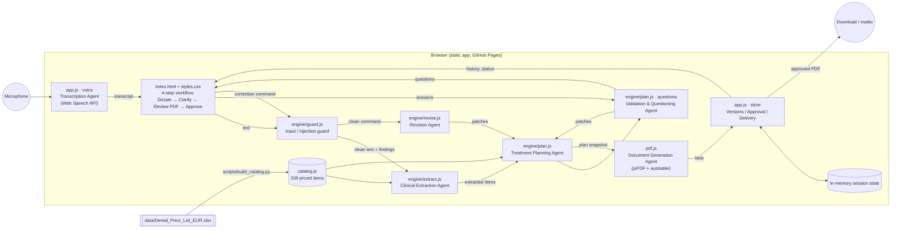
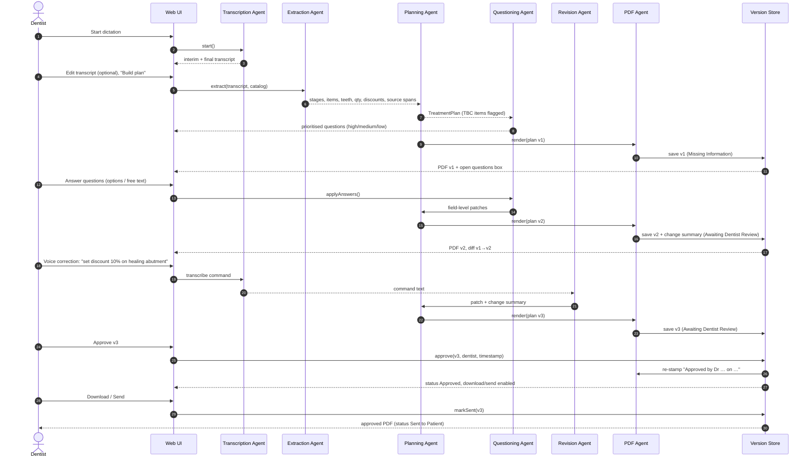
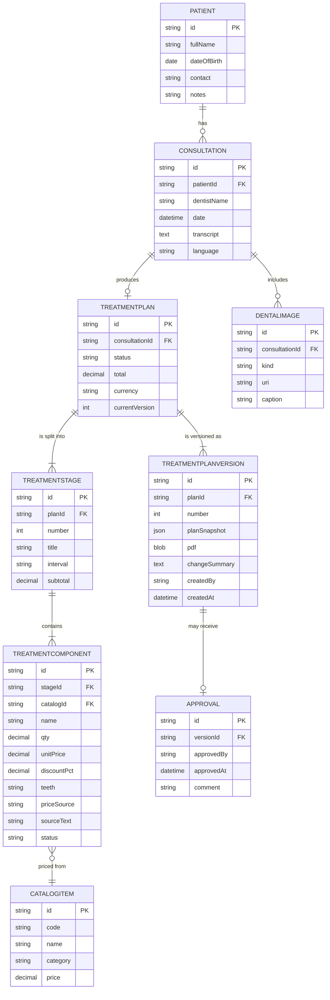
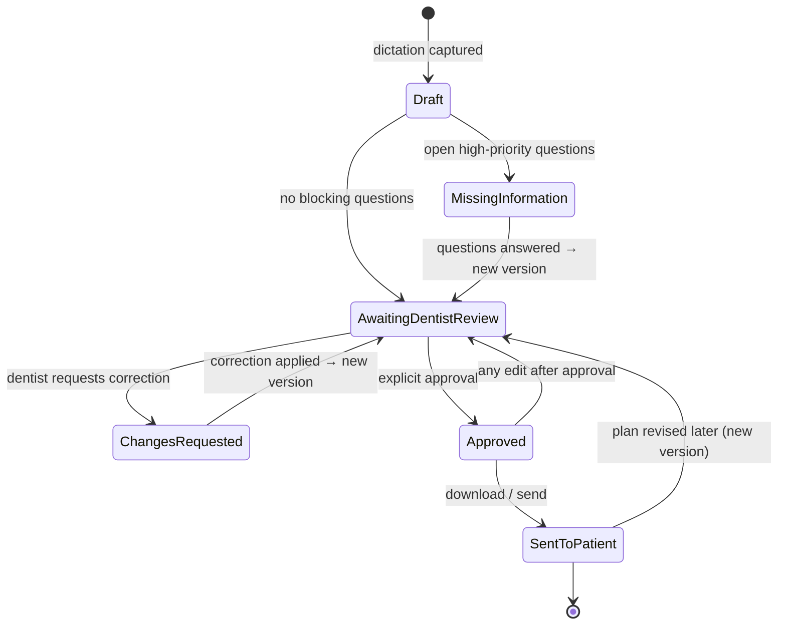
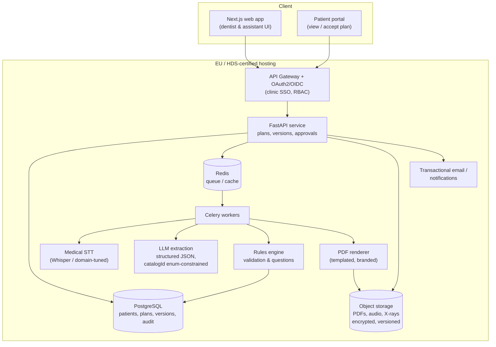

# AI Dental Treatment Plan Assistant: Product and Architecture

Status: MVP / proof of concept (static web app on GitHub Pages)
Audience: product owner, course assessors, engineers taking the POC to production

---

## 1. Problem and goals

Dentists usually write staged treatment estimates by hand after a consultation. This means copying items from a price list, working out quantities per tooth or implant, applying discounts and formatting a document the patient can understand. It is slow and error-prone. Dictated notes are often ambiguous, for example "2–3 implants", "sedation 4 h / without sedation", "with discount" with no percentage, or two different prices for the same item.

**Goal:** the dentist dictates a plan by voice. The assistant turns it into a structured, staged, priced plan built only from the clinic price list, asks the clarifying questions a careful assistant would ask, and produces a versioned, patient-friendly PDF. The PDF can be sent only after the dentist approves it explicitly.

**Success measures (course acceptance criteria):**

1. Understands voice.
2. Asks clarifying questions.
3. Generates a PDF.
4. Regenerates the PDF with the answers.

**Product principles**

- *The dentist stays in control.* The assistant proposes and the dentist decides. Nothing reaches a patient without approval.
- *No invented prices.* Every amount comes from the price list or from a value the dentist dictated or answered.
- *Traceable.* Every line item keeps the source text it came from, and every PDF is a numbered, immutable version.
- *Ask, don't guess.* Ambiguity becomes a question. The assistant does not fill it with a silent assumption.

## 2. Scope

| Capability | MVP (this repo) | Target product |
|---|---|---|
| Voice input | Browser Web Speech API (en-GB, fr-FR), live interim transcript, editable | Server-side medical STT (Whisper / domain-tuned), speaker diarisation, more languages |
| Text input | Free text plus 5 sample dictations | Same, plus EHR import |
| Extraction | Deterministic rule-based NLU against the catalog synonym table | LLM with structured JSON output constrained to catalog IDs, rules as guard-rails |
| Price list | 208 items generated from `Dental_Price_List_EUR.xlsx` | Per-clinic price lists with history, admin UI |
| Clarifying questions | Rule-generated, prioritised, options plus free text | Same, plus LLM-suggested questions validated by rules |
| Corrections | Voice or text commands mapped to field-level patches | Same, plus inline table editing |
| PDF | Client-side jsPDF, branded, watermark, version number | Server-rendered templates, clinic branding, e-signature |
| Images / X-rays | Image attachment embedded in the PDF | DICOM viewer, annotation, storage in a PACS / object store |
| Versioning and audit | In-memory version store with diff and history | PostgreSQL, immutable object storage, signed audit trail |
| Approval | Single-user explicit approval gate | Role-based (dentist, assistant, admin), OAuth2 / SSO |
| Delivery | Download, simulated email (mailto) | Transactional email / patient portal with consent tracking |
| Auth / multi-user | Not in POC | OAuth2 / OIDC, clinic tenancy |

## 3. Logical agents mapped to modules

The system is described as seven cooperating "agents". In the POC each one is a deterministic JavaScript module. In production each becomes a service boundary, and some are LLM-backed.

| # | Agent | Responsibility | POC module |
|---|---|---|---|
| 1 | **Transcription Agent** | Capture speech, show live interim text, let the dentist edit the transcript, text fallback | `src/app.js` (voice section) |
| 2 | **Clinical Extraction Agent** | Split stages and line items, match items to catalog, extract FDI teeth (11–48), quantities, sedation hours, discounts, dictated prices; keep source span and match confidence | `src/engine/extract.js` |
| 3 | **Treatment Planning Agent** | Build the `TreatmentPlan` (stages, intervals, priced items, totals); price only from the catalog or dictated/answered values; unknowns become `TBC` | `src/engine/plan.js` |
| 4 | **Validation & Questioning Agent** | Detect ambiguity, contradictions, missing data; generate prioritised questions with options; apply answers as patches | `src/engine/plan.js` (question generation) |
| 5 | **Revision Agent** | Interpret natural-language corrections ("remove X", "move X to stage 3") as field-level patches with a change summary | `src/engine/revise.js` |
| 6 | **Document Generation Agent** | Render the patient-friendly PDF with version and approval watermark | `src/pdf.js` |
| 7 | **Versioning, Approval & Delivery Agent** | Immutable versions, diff, audit log, status machine, approval gate, download/send | `src/app.js` (version store, approval gate, delivery) |

Input guard (in front of agents 2 and 5): `src/engine/guard.js` strips control characters and HTML, caps the length, and removes prompt-injection sentences (EN/FR). Each removed sentence is flagged to the dentist as a high-priority question. See [SECURITY_AND_PROMPT_INJECTION.md](SECURITY_AND_PROMPT_INJECTION.md).

Supporting data: `src/catalog.js` is generated by `scripts/build_catalog.py` from the xlsx. It holds ids `P001`–`P208`, name, code, category and price.

## 4. Component diagram (MVP)

## 5. End-to-end sequence

## 6. Data model

Entities follow the PRD. In the POC they live as in-memory JSON for the browser session. In production they map to PostgreSQL tables.

`TreatmentComponent.status` values are `matched`, `low_confidence`, `unmatched` and `tbc`. `priceSource` values are `catalog`, `dictated` and `answered`.

## 7. Plan status state machine

Rules:

- Download and send are enabled only when the selected version is `Approved` or `SentToPatient`.
- Approval applies to one specific version number. Any later change creates a new version and resets the status to `Awaiting Dentist Review`.
- Earlier versions are never modified. Each one keeps its own PDF and watermark.

## 8. Anti-hallucination and pricing rules

1. **Catalog-only pricing.** A unit price comes from `catalog.js` (by `catalogId`), from a price the dentist dictated, or from a question answer. The engine never estimates a price.
2. **Unknown means TBC.** An item with no catalog match and no dictated price is shown as `TBC`, excluded from totals and turned into a question. The PDF lists it under "Open questions / assumptions".
3. **Dictated ≠ list.** If a dictated price differs from the list price (for example Straumann €890 dictated vs €830 list), the dictated price is not applied silently. A question asks which one applies.
4. **Contradictions surface.** Two dictated prices for the same item (€890 vs €750) produce a high-priority question.
5. **Counts are checked.** Quantities are cross-checked across stages: implants placed vs healing abutments, temporary crowns and final crowns. Mismatches become questions.
6. **Ranges are never averaged.** "2–3 implants" and "€1,200–1,400" each become a question, or a range shown explicitly in an "approximate estimate".
7. **Discounts need a value.** "With discount" with no percentage triggers a question. "Free of charge" means 100 % with the reason kept. "-30%" applies where it was said.
8. **Provenance.** Every component keeps `sourceText` and `status` so the dentist can see why it is there.
9. **Human gate.** The patient-facing PDF carries a "DRAFT – not approved" watermark until a dentist approves it.

In production, the LLM extractor must return JSON that validates against a schema whose `catalogId` is an enum of the clinic's IDs. Prices are then always joined from the database, never taken from model output.

## 9. Technology stack (MVP) and rationale

| Layer | Choice | Why |
|---|---|---|
| Hosting | GitHub Pages (static) | Free, zero-ops, public demo URL, deploys from CI |
| UI | Vanilla HTML/CSS/ES modules | No build step, fast to iterate in a 30-minute build |
| Speech | Web Speech API | No API keys, no audio leaves the device in supported browsers' local mode; good enough for a demo |
| NLU | Deterministic rules plus synonym table | Reproducible, unit-testable, cannot invent prices, no keys or cost |
| PDF | jsPDF + jspdf-autotable (CDN) | Client-side generation, so patient data stays in the browser |
| Storage | In-memory session state | No backend; patient data never leaves the browser and is cleared on reload |
| Catalog | Python script → JS module | The xlsx stays the source of truth; regenerated on price changes |
| Tests / CI | `node --test`, GitHub Actions | Built in, no dependencies; CI gates the Pages deploy |

**Why static and deterministic for the POC:** the acceptance criteria are about workflow (voice → questions → PDF → regenerated PDF), not model quality. A static app removes every secret and hosting concern, and keeps patient data on the device. Deterministic extraction makes the demo repeatable and testable against the five sample notes, and rules out hallucinated prices. The extraction module has a single interface (`extract(text, catalog) → ExtractedPlan`), so an LLM-backed implementation can replace it later without touching the planner, questions, PDF or store.

Known limitations of the POC: the Web Speech API is not available in every browser (Firefox lacks it), and in Chrome audio may be processed by the browser vendor's servers. Rule-based NLU covers the phrasing in the sample notes and close variants only. Versions are not persisted across reloads. There is no authentication.

## 10. Target production architecture

Key points:

- **Audio** is uploaded to object storage and transcribed asynchronously by a medical STT model with a dental vocabulary (FDI numbers, product names).
- **LLM extraction** uses structured outputs (JSON Schema). `catalogId` is an enum of the clinic's catalog, so the model can only pick existing items. Output is validated, then passed through the same deterministic rules engine as the POC for counts, ranges, discounts and price conflicts. Prices are joined server-side.
- **Versions** are immutable rows plus immutable PDF objects. Approvals are signed and reference a version hash.
- **Async jobs** (STT, extraction, rendering, email) run on Celery with Redis, so the UI stays responsive.
- **Auth** uses OAuth2 / OIDC with roles: dentist (approve), assistant (draft), admin (price list).
- **Hosting** must be EU-based and, for French patients, HDS-certified (Hébergeur de Données de Santé).

## 11. Security, GDPR and HDS

| Topic | MVP | Production |
|---|---|---|
| Data location | Browser memory only; nothing sent to a server we run | EU region, HDS-certified provider |
| Speech | Browser engine; vendor may process audio server-side | Self-hosted or contracted STT under DPA, no training on data |
| Encryption | None beyond the browser profile | TLS 1.2+, AES-256 at rest, KMS-managed keys |
| Access control | None (single local user) | OAuth2/OIDC, RBAC, MFA for dentists |
| Audit | Local audit log per version | Append-only audit log (who/what/when), tamper-evident |
| Retention | Manual clear | Configurable retention per legal requirement for medical records; deletion workflow |
| Data subject rights | N/A (demo data) | Export, rectification, erasure where legally allowed |
| Legal basis | Demo with fictional/translated notes | Health-care provision (GDPR Art. 9(2)(h)); DPA with each clinic; DPIA before launch |
| LLM providers | None | EU-hosted or zero-retention contract; PII minimisation in prompts |

Do not enter real patient data into the public POC.

## 12. Non-functional requirements

| NFR | Target |
|---|---|
| Latency | Plan built and PDF v1 rendered < 3 s after transcript is final (POC: < 1 s, local) |
| Regeneration | New PDF version after answers/correction < 2 s |
| Accuracy | ≥ 95 % of line items in the 5 sample notes matched to the right catalog item or raised as a question; 0 invented prices |
| Reproducibility | Same input yields the same plan (POC deterministic) |
| Availability | Production 99.5 % in clinic hours |
| Accessibility | Keyboard-operable, WCAG 2.1 AA contrast, text fallback for voice |
| Browser support | Chrome / Edge / Safari latest (voice); all modern browsers (text) |
| Auditability | Every version reproducible from its stored snapshot |
| Localisation | EN and FR UI/dictation; EUR currency formatting |

## 13. Risks and mitigations

| Risk | Impact | Mitigation |
|---|---|---|
| Speech misrecognition of tooth numbers or product names | Wrong items or teeth | Editable transcript; teeth validated to FDI 11–48; low-confidence items flagged |
| Rule-based NLU misses unusual phrasing | Item omitted | Unmatched fragments listed as questions and never dropped silently; LLM plug-in point |
| Wrong price applied | Financial or legal exposure | Catalog-only pricing, conflict questions, approval gate, price shown per line |
| Duplicate catalog entries with different prices (e.g. "Temporary crown on implant" €51.37 vs €50.97) | Inconsistent totals | Deterministic preferred-ID mapping; flagged in sample analysis; clinic to clean list |
| Patient receives unapproved plan | Trust / liability | Download/send disabled until approval; DRAFT watermark |
| Data leakage | GDPR breach | POC client-only; production EU/HDS hosting, encryption, RBAC |
| Browser without Web Speech API | Criterion 1 not demonstrable | Text fallback; recommend Chrome/Edge for demo |
| Page reloaded | History lost | Export/download PDFs; production DB |

## 14. Roadmap

| Phase | Scope |
|---|---|
| **0: POC (now)** | Static app, voice dictation, rule-based extraction, questions, versioned PDFs, approval gate, CI + Pages |
| **1: Pilot** | Backend (FastAPI + PostgreSQL), auth, per-clinic price list admin, server-side STT, real email delivery, X-ray storage |
| **2: Intelligence** | LLM extraction with catalog-constrained JSON, rules as guard-rails, evaluation set built from real (consented, anonymised) dictations |
| **3: Integration** | Practice-management/EHR integration, patient portal with acceptance and e-signature, financing options |
| **4: Scale** | Multi-clinic tenancy, analytics (acceptance rate, time saved), additional languages (UK, PL) |
